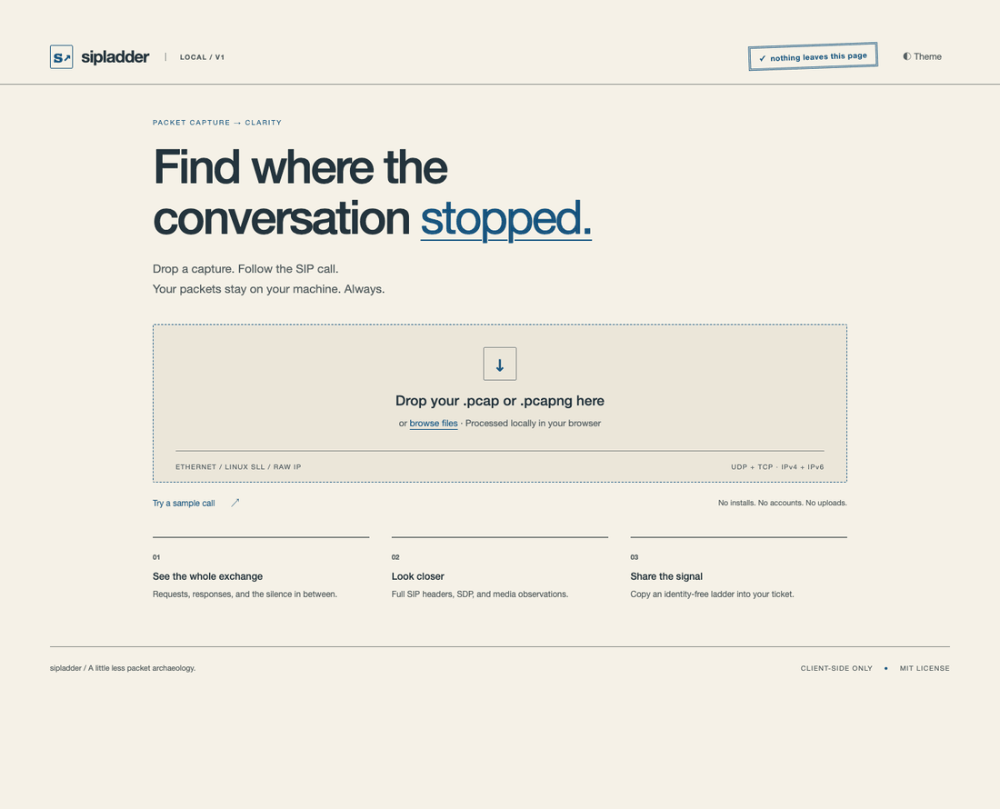

# sipladder

**Drop a packet capture. See the SIP conversation. Nothing leaves this page.**

An engineering-paper SIP workspace with a secondary blueprint theme. A small, static SIP debugging tool for support engineers, telecom integrators, and voice developers. No desktop installation, accounts, analytics, or upload endpoint. Capture parsing runs in a Web Worker; a strict Content Security Policy blocks network connections.



## Run locally

Requires Node.js 22.12+ (tested with Node 26).

```sh
npm ci --ignore-scripts
npm run build
npm run preview
```

Open the localhost address printed by Vite. Drop a `.pcap` or `.pcapng`, or choose **Try a sample call**. The sample is generated locally from synthetic packets. `npm run dev` is also available; strict CSP blocks Vite's development HMR socket, so refresh manually.

## What you get

- Ethernet/VLAN, Linux SLL/SLL2, BSD loopback and raw IP; IPv4/IPv6; UDP and TCP with directional stream reassembly. SIP detection on any port.
- Call-ID conversations with SVG ladders, relative timing, CSeq, status colors, full local headers and SDP. Arrow keys navigate messages; a text-table view provides an accessible alternative.
- Answered/rejected/timeout/cancelled summaries, INVITE-transaction setup time, advertised answer codecs, and RTP presence by direction.
- Unanswered requests and retransmissions, digest challenges, CANCEL/487 and possible one-way audio observations.
- **Copy sanitized ladder** exports numbered endpoints and safe message metadata. It omits URI users, addresses, Call-ID, all raw/auth headers and SDP. The inspector displays original, unsanitized capture data locally.
- Light/dark themes, 100-message pagination, a 256 MiB file limit, and warnings for incomplete captures or unsupported records.

A capture may miss packets or one side of a call. “Timeout” and “one-way audio” describe observed evidence, not definitive network diagnoses. NAT, ICE, late-offer SDP, renegotiation, forks, encrypted SIP and multipart SDP have limitations; see [design and supported formats](docs/design.md).

## Privacy

No capture is sent to a server, written to browser storage, or used for telemetry. Only the initial static application assets load from the host. The parser is bundled as a blob worker, inheriting the page CSP; opening a capture makes no network requests. Production CSP uses `connect-src 'none'`, blocks external scripts/styles/images, and disables forms and objects. No fonts or runtime dependencies are fetched from CDNs. Captured strings are rendered as text, never HTML.

Serve the built files from a trusted dedicated origin. Browser extensions, a compromised host, and the system clipboard remain outside the tool's privacy boundary. **Clear capture** removes the workspace and worker references; it is not a secure-memory-erasure guarantee.

## Develop and verify

```sh
npm test                  # parser, summaries, redaction, eight golden ladders
npm run build             # strict TypeScript + production static build
npm run format:check
npm run fixtures          # regenerate synthetic binary corpus
```

Browser integration checks run against `npm run preview -- --port 4173` in a second terminal:

```sh
npx playwright install chromium --only-shell
npm run test:browser
```

Set `CHROME_PATH` to use a local Chrome executable, or `PLAYWRIGHT_BROWSERS_PATH` for an alternate download location. On restricted macOS runners, `SINGLE_PROCESS=1` avoids denied Mach-port child-process registration. The checks cover file drop, the actual worker, detail selection, keyboard navigation, table, sanitized clipboard, blocked fetch/image attempts, clearing, malformed files, large-capture pagination, themes and mobile layout. They also record the screenshots used for the GIF (`python scripts/make-demo.py`, requires Pillow).

See [corpus and local SIPp/PJSUA capture recipes](docs/corpus.md). Current checked-in captures are synthetic; real privileged capture verification remains a human follow-up.

## Static hosting

`npm run build` produces `dist/`, with relative asset paths for GitHub Pages repository URLs. Serve those files on any static host. A **manual-only** Pages workflow is included; enable Pages via Actions and run it only when you intend to publish. Nothing was pushed, registered, or deployed during the local build.

TypeScript was chosen over Rust/WASM and Pyodide after format research and a local parser benchmark. The project name is provisional; name searches are not legal or domain clearance. Browser alternatives exist, including [SIP Flow](https://www.sipflow.dev/). See [the decision record](docs/design.md).

[MIT license](LICENSE).

## Related tools

[SIP Flow](https://www.sipflow.dev) is a more featureful client-side SIP analyzer: RTP audio playback, sngrep/tshark import, Homer integration, issue detection, share links. If you need those, use it.

sipladder's lane is deliberately narrower: open source you can audit, a CSP (`connect-src 'none'`) that makes "nothing leaves this page" a browser-enforced property rather than a promise, a dependency-free ~25 KB bundle that runs from a local file in air-gapped environments, and a sanitized text export for tickets. Small, verifiable, embeddable.

